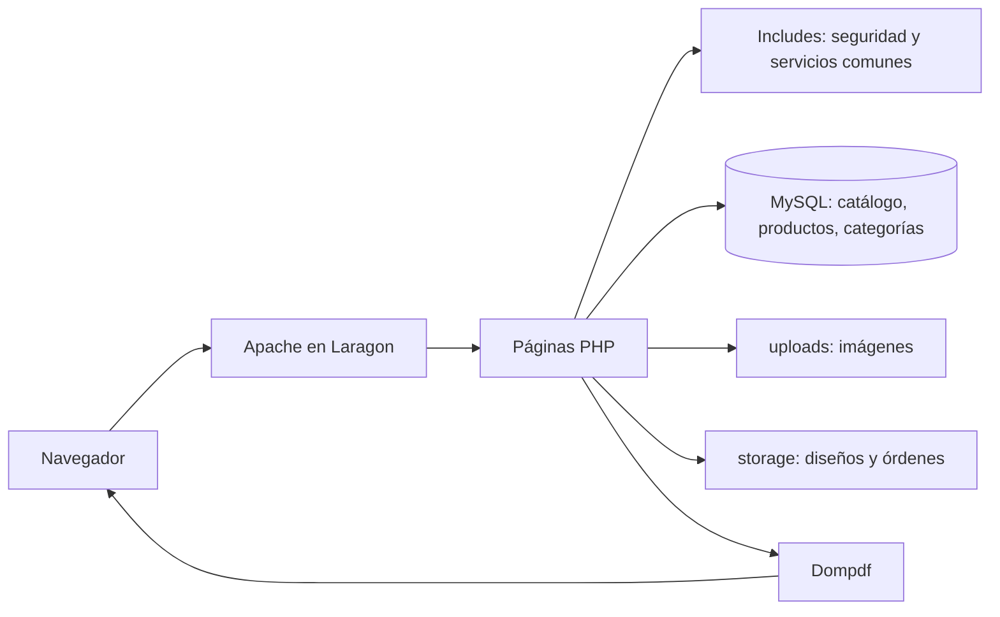

# Guía de sustentación — Catalog Studio

## Presentación del proyecto

Catalog Studio es una aplicación web académica para administrar productos y agruparlos en catálogos. Permite agregar fotografías, personalizar la presentación de cada catálogo y generar un PDF comercial desde los datos registrados.

## Problema y justificación

Preparar catálogos manualmente obliga a repetir la organización de productos, imágenes y precios cada vez que cambia la oferta. El sistema centraliza esos datos en MySQL y permite reutilizarlos en distintos catálogos, manteniendo las fotografías en archivos y el diseño de presentación por catálogo.

## Objetivos

**General:** desarrollar una aplicación local para gestionar catálogos y productos y exportarlos con una presentación personalizable.

**Específicos:**

- Implementar operaciones de creación, consulta, edición y eliminación.
- Relacionar productos con catálogos y categorías.
- Validar y administrar fotografías de forma segura.
- Ofrecer búsqueda, filtros y orden dentro de un catálogo.
- Personalizar la presentación y producir PDF con Dompdf.

## Tecnologías y elección

- **PHP 8.3:** lógica del servidor y renderizado de vistas.
- **MySQL 8.4:** persistencia relacional de catálogos, productos y categorías.
- **PDO:** acceso a datos con sentencias preparadas.
- **HTML5, CSS3 y JavaScript:** formularios, interfaz adaptable y vista previa interactiva.
- **Dompdf 3.1.6:** generación de documentos PDF desde HTML/CSS compatible.
- **Laragon/Apache en Windows:** entorno local de ejecución.

## Arquitectura

Las páginas manejan solicitudes y vistas; los archivos de `includes/` reúnen conexión, validaciones, carga segura de imágenes y persistencia local del diseño/orden. MySQL mantiene entidades y relaciones. Los archivos multimedia no se guardan como BLOB.

## Módulos y datos

- **Dashboard y navegación:** indicadores calculados en MySQL y accesos a módulos.
- **Catálogos:** datos generales, detalle, contador, edición, duplicación y eliminación.
- **Productos:** nombre, descripción, precio, categoría, catálogo e imagen; búsqueda y filtros.
- **Categorías:** tabla global consultada por formularios; una categoría puede clasificarse en muchos productos.
- **Diseñador:** plantilla y opciones por catálogo en `storage/catalog_designs/`.
- **Orden:** IDs ordenados por catálogo en `storage/product_orders/`.
- **PDF:** consulta los productos del catálogo, aplica orden/diseño y entrega un PDF completo o seleccionado.

Relaciones reales: `catalogs` uno a muchos `products`; `categories` uno a muchos productos, con `category_id` nullable. Al borrar catálogo, la FK elimina sus productos (`ON DELETE CASCADE`); al borrar categoría, los productos quedan sin categoría (`ON DELETE SET NULL`). El campo `catalogs.category` es texto libre, no una FK.

## Seguridad implementada

- Tokens CSRF de sesión para operaciones de escritura.
- Consultas parametrizadas cuando se incorporan valores externos.
- Validación de identificadores, longitudes, campos requeridos y precio.
- Verificación en base de datos de catálogos/categorías y de pertenencia del producto al catálogo.
- Escape HTML para valores mostrados.
- MIME real con Fileinfo, máximo de 3 MB, nombres aleatorios y formatos JPEG/PNG/WEBP.
- Verificación de referencias antes de eliminar imágenes compartidas.
- Dompdf sin acceso remoto, PHP ni JavaScript, y limitado por `chroot`.
- Protección HTTP de `uploads/` mediante configuración Apache y `.htaccess`; `storage/` niega acceso HTTP.

El proyecto no incluye autenticación ni roles; está destinado a un operador en una instalación local controlada.

## Retos técnicos y decisiones

1. **Separar datos y recursos:** las tablas contienen referencias y metadatos; las imágenes se guardan como archivos.
2. **Mantener referencias válidas:** una imagen solo se elimina después de revisar referencias de producto y diseño, lo que soporta imágenes compartidas al duplicar catálogos.
3. **Personalizar sin migración:** cada diseño se guarda por ID en archivos de `storage/catalog_designs/`; el orden de productos se guarda separadamente en `storage/product_orders/`. Así no se añadieron tablas ni columnas.
4. **Compatibilidad PDF:** Dompdf compone el documento desde HTML y CSS compatible con su motor; usa imágenes locales y no carga recursos remotos.
5. **Consistencia relacional:** las claves foráneas definen los efectos de borrar catálogo o categoría.

## Demostración práctica de 10 minutos

Antes de presentar: inicia Laragon, confirma Apache/MySQL y puerto `3307`, abre la URL local, y prepara un respaldo. Usa datos ya existentes o registros claramente marcados `DEMO_`; no uses ni elimines datos reales sin autorización.

| Tiempo | Demostración |
|---|---|
| 0:00–1:00 | Presentar el problema, objetivo y dashboard. Explicar que los indicadores salen de MySQL. |
| 1:00–2:00 | Abrir catálogos; mostrar contador, detalle y estados disponibles. |
| 2:00–3:30 | Mostrar creación/edición de un catálogo y validación de campos. |
| 3:30–5:00 | Crear o abrir un producto; mostrar categoría, precio y carga/vista de fotografía. |
| 5:00–6:00 | Buscar producto y aplicar filtros por catálogo y categoría. |
| 6:00–7:00 | Reordenar productos y explicar persistencia sin cambio del esquema MySQL. |
| 7:00–8:00 | Duplicar un catálogo; explicar que se copian referencias de imagen, no archivos físicos. |
| 8:00–9:00 | Abrir diseñador, cambiar plantilla/color y mostrar la vista previa. |
| 9:00–10:00 | Exportar PDF completo y/o selección; cerrar con seguridad, modelo de datos y limitaciones. |

Evita ejecutar eliminaciones durante la sustentación. Si se usa un registro `DEMO_`, elimínalo solo al terminar y después de verificar que pertenece a la demostración.

## Preguntas probables

**¿Por qué se usa PDO?**  
Permite parametrizar consultas, reducir el riesgo de inyección SQL y manejar errores de base de datos de forma consistente.

**¿Dónde se guarda el diseño personalizado?**  
En un archivo por ID de catálogo dentro de `storage/catalog_designs/`, no en una tabla. Debe respaldarse junto con la base.

**¿Cómo se evita asociar un producto al catálogo equivocado en un PDF?**  
El servidor consulta productos con el ID del catálogo y comprueba que la cantidad devuelta coincide con la selección enviada.

**¿Qué ocurre al eliminar un catálogo?**  
La FK usa `ON DELETE CASCADE` para eliminar sus productos. La aplicación después limpia archivos de diseño/orden y elimina fotografías únicamente si no quedan referencias.

**¿Qué pasa cuando se elimina una categoría?**  
La FK `ON DELETE SET NULL` conserva los productos y deja `category_id` vacío.

**¿Por qué no guardar el orden en MySQL?**  
El esquema actual no tiene una columna de orden. Se decidió usar un archivo por catálogo, evitando migración; por eso el directorio `storage/product_orders/` debe respaldarse.

**¿La copia del catálogo duplica las imágenes?**  
No. Duplica registros de producto y conserva el nombre de archivo, compartiendo físicamente la imagen. El borrado comprueba referencias antes de quitar el archivo.

**¿La aplicación está lista para publicarse en Internet?**  
No. No cuenta con autenticación ni roles y está configurada para entorno local académico. Una publicación requiere control de acceso y revisión de configuración y despliegue.

## Cierre y conclusiones

Catalog Studio integra gestión relacional, recursos multimedia y salida editorial en PDF dentro de una aplicación PHP local. El diseño modular separa validación, acceso a datos y almacenamiento de archivos. Para la entrega debe conservarse el respaldo combinado de MySQL y carpetas de almacenamiento, y deben completarse las comprobaciones manuales indicadas en el informe de auditoría.
