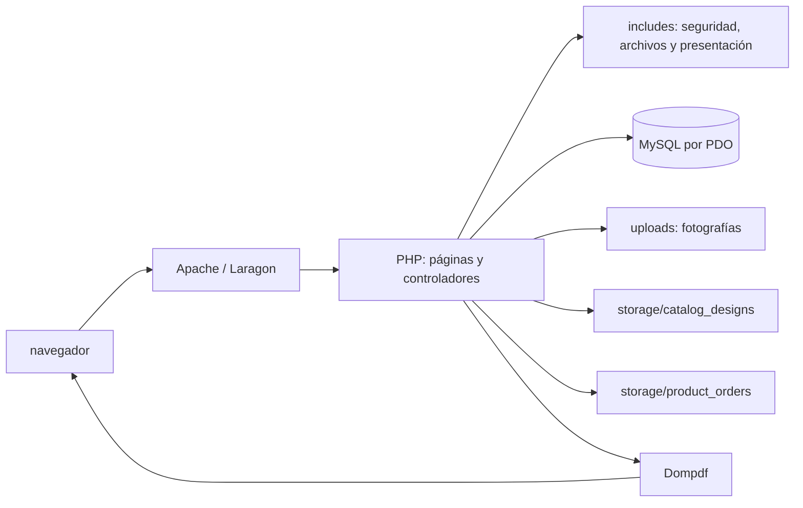
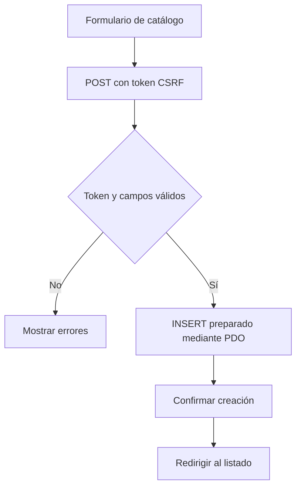
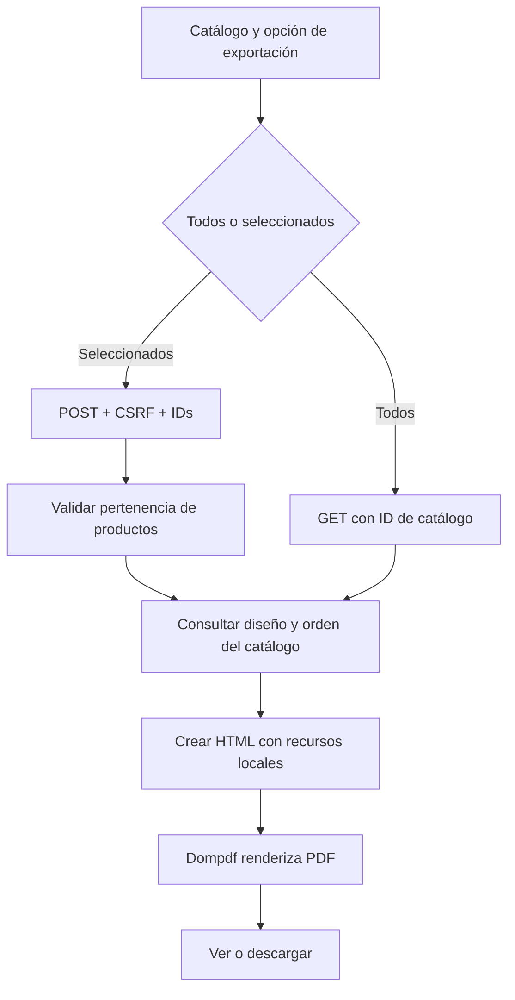

# Catalog Studio

Aplicación web académica para organizar productos en catálogos, personalizar su presentación y generar documentos PDF. Está desarrollada con PHP y MySQL y pensada para ejecutarse localmente en Laragon.

## Problema, justificación y objetivos

Cuando los productos, sus categorías y sus fotografías se administran por separado, preparar un catálogo comercial coherente requiere trabajo manual y repetitivo. Catalog Studio centraliza esos datos y permite presentar una selección de productos con una identidad visual propia.

**Objetivo general:** ofrecer una herramienta web local para administrar productos y catálogos y exportar estos últimos como documentos PDF personalizados.

**Objetivos específicos:** administrar catálogos y productos; clasificar productos mediante categorías; mantener fotografías asociadas; personalizar la presentación de cada catálogo; y generar PDF con todos los productos o una selección.

**Alcance:** aplicación de un solo espacio de trabajo local. Incluye CRUD, búsqueda y filtros de productos, orden manual por catálogo, duplicación de catálogos, diseños por catálogo y exportación PDF. No incorpora autenticación ni roles de usuario.

## Funcionalidades

- Dashboard con totales calculados desde MySQL.
- Crear, listar, consultar, editar, duplicar y eliminar catálogos.
- Crear, listar, editar y eliminar productos; asignarlos a un catálogo y categoría.
- Cargar, reemplazar y visualizar fotografías de producto y recursos del diseñador.
- Buscar productos por nombre y filtrar por catálogo y categoría.
- Cambiar el orden de productos dentro de cada catálogo.
- Personalizar portada, colores, tipografía, disposición y visibilidad de elementos.
- Generar PDF de todos los productos de un catálogo o de los seleccionados.

## Tecnologías y requisitos comprobados

- Windows y Laragon; URL local: `http://localhost/catalog_studio/`.
- PHP 8.3 (entorno auditado: 8.3.33), con PDO MySQL, Fileinfo, mbstring y GD.
- MySQL 8.4 (entorno auditado: 8.4.3), host `127.0.0.1`, puerto `3307`.
- Composer; Dompdf `3.1.6`, bloqueado en `composer.lock` y declarado como `^3.1` en `composer.json`.
- Apache con soporte para `.htaccess` y `mod_authz_core` (`Require all denied`).
- Navegador moderno con JavaScript habilitado.

El entorno local actual usa el usuario MySQL `root` y contraseña vacía, según `config/db.php`. Es una configuración de desarrollo local; no se debe reutilizar ni exponer en una red o servidor de producción. No se documentan secretos de producción.

## Arquitectura



Las páginas PHP reciben solicitudes, validan formularios y delegan funciones comunes a `includes/`. PDO conecta con MySQL; las fotografías y los datos del diseñador se guardan en archivos locales. Dompdf compone el PDF con imágenes locales permitidas por su `chroot`.

#### Flujo de creación de catálogo



#### Flujo de generación PDF



#### Flujo de creación de catálogo


#### Flujo de generación PDF


### Estructura de carpetas

```text
assets/                    CSS y JavaScript del cliente
config/db.php              Conexión PDO y arranque de sesión
includes/                  Seguridad, carga de imágenes, diseño y orden
storage/catalog_designs/   Configuración visual por catálogo
storage/product_orders/    Orden manual por catálogo
uploads/                   Fotografías cargadas
vendor/                    Dependencias Composer (generada localmente)
database.sql               Creación inicial de base y tablas
catalog_*.php              Páginas y acciones de catálogos
product_*.php              Páginas y acciones de productos
export_pdf.php             Vista previa/descarga Dompdf
index.php                  Dashboard
```

Los archivos generados de diseños, órdenes y fotografías se excluyen total o parcialmente de Git mediante `.gitignore`; su presencia en GitHub no está garantizada.

### Módulos principales

- `index.php`, `catalogs.php`, `products.php`: dashboard y listados.
- `catalog_create.php`, `catalog_edit.php`, `catalog_delete.php`, `catalog_duplicate.php`, `catalog_view.php`: administración y detalle de catálogos.
- `product_create.php`, `product_edit.php`, `product_delete.php`, `product_reorder.php`: productos, imágenes y orden.
- `catalog_designer.php`, `catalog_design_reset.php`: editor y restablecimiento del diseño.
- `export_pdf.php`: selección de productos, armado de HTML y renderizado con Dompdf.
- `includes/security.php`: escape HTML, CSRF, validación de entradas y mensajes.
- `includes/image_upload.php`: verificación MIME, rutas, uso y eliminación segura de imágenes.
- `includes/catalog_design_store.php`, `includes/product_order_store.php`: persistencia local de los ajustes y del orden.

## Base de datos

`database.sql` crea la base `catalog_studio` con `utf8mb4`, las tablas `catalogs`, `categories` y `products`, e inserta categorías iniciales mediante `INSERT IGNORE`. No se requiere una migración para el diseñador ni el orden: esos ajustes se almacenan en archivos.

```mermaid
erDiagram
    CATALOGS ||--o{ PRODUCTS : contiene
    CATEGORIES o|--o{ PRODUCTS : clasifica
    CATALOGS {
        int id PK
        varchar name
        varchar category
        text description
        timestamp created_at
        timestamp updated_at
    }
    CATEGORIES {
        int id PK
        varchar name UK
    }
    PRODUCTS {
        int id PK
        int catalog_id FK
        int category_id FK_nullable
        varchar name
        text description
        decimal price
        varchar image
        timestamp created_at
    }
```

`products.catalog_id` referencia `catalogs.id` con `ON DELETE CASCADE`; eliminar un catálogo elimina sus productos asociados. `products.category_id` referencia `categories.id` con `ON DELETE SET NULL`; borrar una categoría conserva los productos y deja su categoría sin asignar. El nombre de categoría es único. La categoría textual de un catálogo (`catalogs.category`) no es una relación con `categories`.

## Instalación en Laragon

1. Coloca el proyecto en `C:\laragon\www\catalog_studio` e inicia Apache y MySQL desde Laragon.
2. Comprueba que MySQL escuche en `3307` y que `config/db.php` contenga el host, base y credenciales locales esperados. El puerto no se cambia desde esta guía.
3. Crea/importa la base ejecutando `database.sql` con HeidiSQL o phpMyAdmin. El script crea tablas solo si no existen e inserta categorías que todavía no están; antes de ejecutarlo sobre una base con datos, realiza una copia de seguridad.
4. Instala las dependencias bloqueadas desde la raíz del proyecto: `composer install`. Esto crea `vendor/` e instala la versión de Dompdf fijada por `composer.lock`. En el entorno auditado Composer está en `C:\laragon\bin\composer\composer.phar`; si el comando `composer` no está en `PATH`, ejecuta `C:\laragon\bin\php\php-8.3.33-Win32-vs16-x64\php.exe C:\laragon\bin\composer\composer.phar install` desde la raíz del proyecto.
5. Verifica que `uploads/`, `storage/catalog_designs/` y `storage/product_orders/` existan y sean escribibles por Apache/PHP. No abras permisos generales innecesarios.
6. Abre `http://localhost/catalog_studio/`.

### Apache y protección de `uploads/`

El repositorio incluye `uploads/.htaccess`, que deshabilita listados y CGI, permite servir solamente nombres de imagen generados por la aplicación y fuerza el manejador estático para esas imágenes. En el entorno auditado también existe, fuera del repositorio, `C:\laragon\etc\apache2\sites-enabled\catalog_studio_uploads.conf`:

```apache
<Directory "C:/laragon/www/catalog_studio/uploads">
    AllowOverride All
    Options -Indexes -ExecCGI
    Require all granted
</Directory>
```

Al instalar en otra ruta de Laragon, crea el archivo equivalente en `sites-enabled`, ajusta el path absoluto y reinicia Apache. `AllowOverride All` permite aplicar las reglas del `.htaccess`; confirma que la versión de Apache tenga habilitado `mod_authz_core`. El `.htaccess` del proyecto no reemplaza la configuración `<Directory>` de Apache.

`storage/.htaccess` niega las solicitudes HTTP a esa carpeta. PHP sigue leyendo y escribiendo sus archivos internos mediante rutas locales.

## Uso

1. Desde el dashboard, crea un catálogo con nombre, categoría textual opcional y descripción.
2. Abre el catálogo y crea productos; selecciona una categoría y completa precio, descripción y, si corresponde, fotografía.
3. En **Productos**, busca por nombre y filtra por catálogo o categoría.
4. En el detalle de un catálogo, reordena productos con las flechas, edita sus datos o duplica el catálogo. La copia incluye productos y configuración visual, y comparte los nombres de fotografía existentes; no duplica físicamente las imágenes.
5. Abre **Personalizar diseño** para cambiar plantilla, colores, tipografías, portada y disposición. Guarda para persistir cambios o usa la vista previa interactiva.
6. Usa **Ver PDF** o **Descargar PDF** para todos los productos. Marca **Incluir en PDF** en los productos deseados y usa **PDF de seleccionados** para exportar solo esos.

### Generación PDF

La aplicación requiere `vendor/autoload.php`; si Dompdf no está instalado, la ruta PDF responde con un error de disponibilidad. No existe una alternativa de impresión del navegador en el flujo actual. Dompdf tiene acceso remoto, PHP y JavaScript deshabilitados y usa el directorio del proyecto como `chroot`. Las imágenes se leen desde `uploads/` y se convierten a data URI tras validar ruta, tamaño y MIME.

## Seguridad y validaciones

- Los formularios de escritura verifican token CSRF de sesión en el servidor.
- Las consultas con datos de entrada usan sentencias preparadas PDO; los listados sin entrada usan consultas directas.
- Se validan identificadores, existencia de catálogo/categoría, longitudes, campos obligatorios y formato de precio.
- La salida dinámica se escapa con `htmlspecialchars` en UTF-8.
- Las imágenes se validan con Fileinfo, se limita su tamaño a 3 MB y se generan nombres aleatorios. Se permiten JPEG, PNG y WEBP.
- Los archivos se guardan fuera de la base y se eliminan solo tras verificar que no tengan referencias en productos o diseños.
- El PDF valida que los productos seleccionados pertenezcan al catálogo solicitado.
- Los archivos de diseño y orden están ligados a IDs de catálogo; el orden se filtra contra los IDs de productos consultados. Las acciones de reordenamiento comprueban explícitamente esa pertenencia.
- Los errores de conexión PDO se registran en el log del servidor y se muestra un mensaje genérico al visitante.

**Límite de seguridad:** no hay autenticación ni autorización por usuario. La aplicación está preparada como entorno local de un solo operador; no se debe publicar en una red compartida o Internet sin añadir control de acceso y revisar configuración de sesiones y servidor.

## Archivos, respaldo y restauración

- `uploads/`: fotografías de productos, logotipos y portadas. Los nombres suelen ser aleatorios; los registros contienen referencias.
- `storage/catalog_designs/`: un archivo PHP de datos por catálogo y archivos `.lock` de sincronización. Los archivos contienen configuración normalizada y tienen una guarda contra acceso directo.
- `storage/product_orders/`: un archivo PHP con la secuencia de IDs de producto por catálogo, más archivos de bloqueo. Los registros se contrastan con los productos del catálogo al leerlos.

Para respaldar, detén cambios en el sistema y guarda conjuntamente:

```powershell
mysqldump --host=127.0.0.1 --port=3307 --user=root catalog_studio > catalog_studio.sql
Copy-Item uploads -Destination backup\uploads -Recurse
Copy-Item storage\catalog_designs -Destination backup\catalog_designs -Recurse
Copy-Item storage\product_orders -Destination backup\product_orders -Recurse
```

Los comandos son ilustrativos; crea previamente `backup\` fuera de la carpeta pública y confirma que el archivo SQL se generó. El comando `mysqldump` anterior no incluye por defecto una sentencia para crear la base: para restaurar, crea primero `catalog_studio` con `utf8mb4`, importa el dump en esa base, copia las tres carpetas al proyecto restaurado y conserva permisos de escritura para PHP. Por ejemplo, en PowerShell: `mysql --host=127.0.0.1 --port=3307 --user=root -e "CREATE DATABASE catalog_studio CHARACTER SET utf8mb4 COLLATE utf8mb4_unicode_ci"` y luego `mysql --host=127.0.0.1 --port=3307 --user=root catalog_studio < catalog_studio.sql`. Ejecuta la restauración en un destino vacío o controlado; no importes sobre datos que necesites conservar sin evaluar colisiones. Mantén la relación entre el respaldo SQL y los archivos del mismo momento: un nombre de imagen sin archivo, o un archivo sin respaldo de base, produce una referencia incompleta. Los archivos `.lock` pueden incluirse; no sustituyen los datos del archivo principal.

GitHub no incluye necesariamente estos datos: `uploads/*` y los archivos generados de diseño/orden están ignorados. El repositorio conserva reglas de Apache y archivos `index.php` de protección, no el conjunto de datos cargados.

## Limitaciones y trabajo futuro

- Sin cuentas, roles, auditoría de usuario ni aislamiento entre operadores.
- Los diseños y el orden se guardan en el sistema de archivos; para mover la aplicación hay que trasladar esas carpetas junto con la base.
- La vista previa interactiva depende del navegador; la salida final la compone Dompdf y puede variar respecto al navegador.
- El comportamiento responsive, las cargas límite y las confirmaciones requieren verificación manual en navegador.
- Como mejoras futuras se podrían evaluar autenticación, pruebas automatizadas de integración y copias de seguridad automatizadas. No forman parte de la implementación actual.

## Documentos del proyecto

- `GUIA_SUSTENTACION.md`: presentación oral sugerida y preguntas técnicas.
- `INFORME_AUDITORIA_FINAL.md`: alcance de la revisión, matriz de pruebas, resultados y pendientes.
